# UI review — learn firmware 0.3 (FM-1 and SMK-37 Elite)

**Scope:** every screen of the four pages, the welcome screen, the help and the results log, on both boards, with the
device lights. Judged against one question: *can a beginner do everything by reading the synth's own screen?*

**Verdict:** the frame is sound (pages, help, results, prompts on bars, board-correct names), but there are
**4 critical issues** that teach something wrong or break the learning loop, **9 high** that a first-time user will hit
in the first session, and a tail of medium/low polish. The critical ones are small code changes except C4 (content).

| Severity | Count | Theme |
| --- | --- | --- |
| Critical | 4 | wrong theory on screen, lessons that pass when you fail, drills that show the answer, no guided path after page 1 |
| High | 9 | overlapping or clipped text, stale screens, progress lost at power-off, controls not mapped on screen, dark pads |
| Medium | 13 | labels and abbreviations, idle space, overlays, trainer feedback |
| Low | 6 | duplicates and small polish |

## How this was reviewed

- `learn/tests/learn_review.c` drives a scripted tour (47 states) through SLOOP's own UI harness and writes each
  screen with the device's lights under it. It is built twice: `LEARN_UI_SMK=0` (FM-1) and `LEARN_UI_SMK=1`
  (SMK-37's names, 37-key strip, pad palette, pad colours). Rebuild the gallery with the commands at the top of that
  file.
- Every example image below is **FM-1 on the left, SMK-37 on the right**. Under the FM-1 screen: its 27 key LEDs
  (dim = sounding, bright = follow-me). Under the SMK-37 screen: its 16 pads (top row 1–8, bottom row 9–16) in the
  RGB the firmware sends.
- Text widths were checked against the screen (29 characters of `FONT_S`) with the SMK-37's longer button names
  substituted.
- **Limits:** the SMK-37 screens are rendered on the FM-1 SLOOP harness with the SMK UI switched on, so keys outside
  F3–G5 were not pressed and the SMK hardware path (pads through the outer-key queue, faders) is exercised only by
  injecting events. Pad colours are the values sent, not measured LED light — real pads may look brighter or
  dimmer. Nothing here replaces a session on the device.

---

## Critical

### C1 — Roman numerals lose their case: minor chords are shown as major (both boards, every page)

SLOOP's font folds lower case to upper case (`gfx.c glyph()`), so `ii iii vi vii°` are drawn as `II III VI VII`.
In Roman-numeral notation the case *is* the information (upper = major, lower = minor). The screen therefore says
the D minor chord in C major is "II" — it teaches the wrong thing, on the page 1 pad palette, the progression line,
the big line, page 2's chord row, page 4's slot hints, and lesson 16's prompt ("vi IS MINOR'S HOME…").

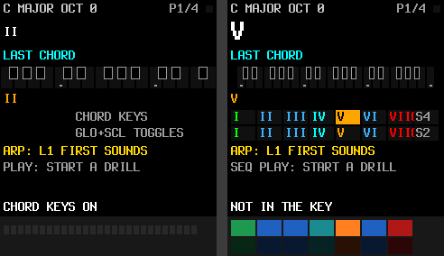
*Pad palette (right) and the FM-1 chord key on D (left): `II` where it should read `ii`. The same on page 2:*
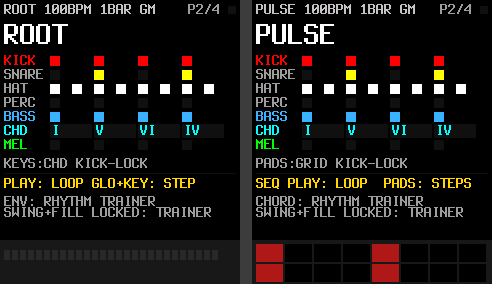

**Fix:** a notation that survives capitals — `IIm`, `IIIm`, `VIm`, `VIIo` (and `IIo` in minor) — together with the
existing function colours; or add lower-case glyphs for the learn layer only. Change `theory_roman()` and lesson 16.

### C2 — A failed drill still advances the lesson, and the lesson completes (both boards)

`lesson_step_done(passed, score)` ignores `passed` (`learn/main.c`): a step with 3 of 10 right moves on, the last
step "completes" the lesson, it is logged, and its unlocks fire. The per-step `target` in the lesson JSON (50 %,
60 %, 70 %…) is never used; page 1 uses a fixed 80 % only for the *notice* ("KEEP GOING"). So the screen says
"KEEP GOING" and then "LESSON DONE!" a moment later.

**Fix:** repeat the step until `score >= step.target`; after two misses offer slow mode ("TRY SLOW: K6"); log the
lesson's attempts and final score, not the last step's.

### C3 — Ear drills show the answer (both boards)

Follow-me lights the target key (strip and FM-1 LEDs) and the target pad, and the FM-1 staff draws the target note,
during **LISTEN and YOUR TURN**. An echo drill becomes "press the lit key"; a chord drill on the SMK becomes "press
the bright pad". The skill the drill exists to train (hearing it) is bypassed.

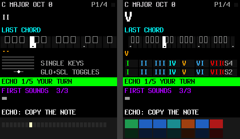
*Echo drill, your turn: the answer is lit in the strip, on the FM-1 LEDs and on the FM-1 staff.*
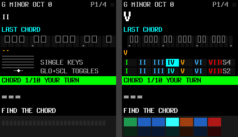
*Chord drill: IV highlighted on the SMK palette and its pad at full brightness.*

**Fix:** no follow-me by default in echo/chord/progression drills; show it after a miss ("HERE IT IS"), or as an
explicit "SHOW ME" toggle, or only in the first two lessons. Keep follow-me for the scale drill (it *is* the point
there).

### C4 — Pages 2–4 have no lessons (content)

All 20 lessons are page 1 lessons (`stage: 1`; step types used: text, echo, scale, chord, progression). The code
supports `rhythm`, `groove`, `reftake` and `song` steps, but no lesson uses them. On page 2 ARP starts a page-1
lesson and says "THIS STEP IS ON PAGE 1"; page 3 says "NO PAGE 3 LESSON IN THIS PACK"; page 4 says
"NOT A SONG LESSON". Each page's help promises "HOW TO LEARN HERE", but after page 1 there is no guided path.

**Fix:** write 5–8 lessons per page (page 2: on-beat taps → a groove to match → a chord loop → a melody take;
page 3: one rule per lesson with the source/shadow demo; page 4: verse/chorus → a ghost order to perform).

---

## High

### H1 — Page 2: the bottom lines overlap (both boards)

`CHORD: RHYTHM TRAINER` (y = 194) and `SWING+FILL LOCKED: TRAINER` (y = 205) are 11 px apart with a 16 px font.

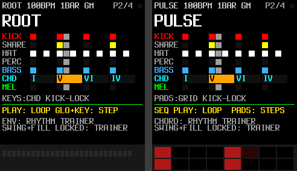

**Fix:** one line, or 18 px spacing (move the lock line to 212 and keep the notice at 222 clear).

### H2 — "LESSON DONE!" is overwritten, and "ARP: NEXT" repeats the same lesson (both boards)

The lesson's completion notice is set, then immediately replaced by the drill's "PASSED!". The result card then
says `ARP: NEXT`, but the lesson pick never advances, so ARP restarts lesson 1.

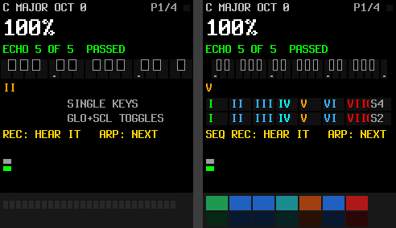

**Fix:** after a lesson completes, advance the pick to the next lesson, show "LESSON 1 DONE — ARP: LESSON 2
<title>" in the card, and let the drill notice yield to the lesson notice.

### H3 — Progress is lost at power-off (both boards)

The practice log, the lesson reached, the unlocks (swing, fill) and the pages' work live in RAM by design (the layer
writes no Flash). A learner who practises daily starts every session at "ARP: L1 FIRST SOUNDS", with swing locked,
and an empty results log.

**Fix:** keep a 16–32-byte progress record (next lesson, unlocks, streak) in SLOOP's own settings storage, which
SLOOP already writes safely and autosaves — no new Flash path. Failing that, show the next lesson's number
prominently so the learner can dial it with K7/K6.

### H4 — Changing the key leaves stale content (both boards)

After GLOBE+key / SCALE, the big line still shows the last chord of the *old* key, the progression line keeps it,
and the SMK pad palette keeps the major-key labels and colours until a chord is played (`s1_minor` only updates on
play).

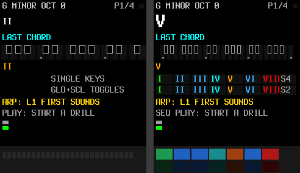
*Header says G MINOR; the big line and progression still show the C-major chord; the palette is unchanged.*

**Fix:** on a key change, clear the last chord and progression, and recompute the palette from `x->minor`.

### H5 — FM-1: the staff covers the progression line

The staff clears from y = 106, the progression line is drawn at y = 102 (16 px tall), so its bottom is erased and
orange fragments remain above the staff.

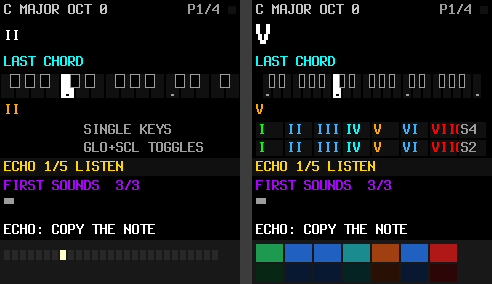

**Fix:** move the progression line up or the staff down by 6 px, or draw the progression to the right of the staff
on the FM-1.

### H6 — Clipped text (both boards)

Strings longer than the 29-character line run off the right edge:

| Where | Text (length) |
| --- | --- |
| page 1 why-hint | `I IS HOME. EVERYTHING RESTS HERE` (32) |
| page 3 rule hints | 6 of 8, e.g. `3RD ABOVE: MELODY +2 SCALE STEPS` (32) |
| page 4 transition hints | `HAND-OFF: MELODY FADES, CHORD EARLY` (35), `DROP: …` (30), `FILL: …` (30) |
| page 4, SMK | `PAD: SLOT GLOBE+PAD 9-16 STORE` (30) |
| page 4, built at run time | `RECORDING 2 SECTIONS  PATCH: STOP` |

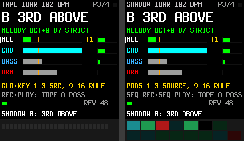
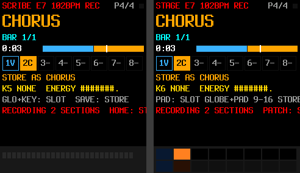

**Fix:** shorten these, and make `learn_notice()` / `ld_text()` truncate with a trailing `>` in debug builds so the
host suite catches the next one.

### H7 — Lesson prompts assume the SMK-37 (FM-1)

Lesson prompts are shared, but say `PRESS THE GREEN PAD`, `GREEN (I) OR ORANGE (V)?`, `BOTTOM PADS: WHICH 7TH?` —
the FM-1 has no pads; its chord keys are not coloured. `COPY THE BLUE NOTES` (lesson 15) refers to nothing on either
board.

**Fix:** optional `prompt_fm1` in the lesson JSON (generator emits both, the firmware picks by board); rewrite
lesson 15's prompt.

### H8 — Pages 2–4 don't show what the controls map to (both boards)

To use these pages from the screen alone you need a map the screen never shows:

- **Page 3:** which of pads/keys 9–16 is which rule (HOLD, ARP, 3RD ABOVE, 6TH BELOW, ECHO, ANSWER, TOP NOTE,
  GHOST). Not on the screen, not in the help.
- **Page 2, FM-1:** GLO + keys 1–16 are the steps, 17–19 the bass rules — no key↔step picture.
- **Page 2, SMK, chord mode:** the pads play chords, but there is no on-screen palette (page 1 has one).

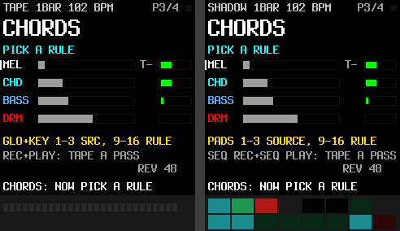
*Source armed: "PICK A RULE" — but which pad is which rule?*

**Fix:** when a source is armed, replace the lanes with the rule list (`9 HOLD 10 ARP …`, the valid ones bright);
add a "RULES" screen to page 3's help; on page 2 show the chord palette in chord mode and a step ruler under the
selected lane when GLO is held on the FM-1.

### H9 — SMK-37: many pads are almost black

`P_DIM()` is a quarter of the colour, so the 7th-chord row, the sus pads, the rule pads on page 3, the store pads on
page 4 and the beat markers on page 2 come out near 0x0A0A0A–0x181818: on the device they will read as "off". Only
one or two pads look alive on several pages.

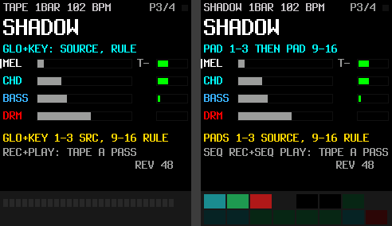
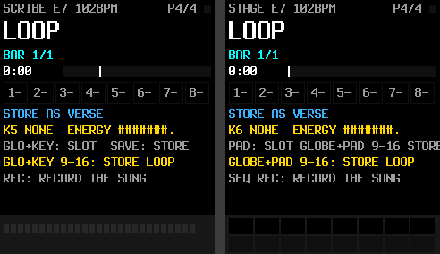

**Fix:** dim = half, not a quarter; a floor of ~0x30 per lit channel; empty-but-usable pads (store slots) a faint
white rather than off.

---

## Medium

| ID | Board | Issue | Example | Fix |
| --- | --- | --- | --- | --- |
| M1 | both | The help and the log don't pause a drill or the trainer: rounds time out as misses behind the overlay. | — | Pause drills/trainer while an overlay is up (the loop may keep playing). |
| M2 | both | Results log: `TODAY` counts since power-on (no clock); entries have no order cue; a lesson entry shows only its last step's score. | `p1-13-log` | `SESSION` instead of `TODAY`; number the entries; log the lesson's overall result. |
| M3 | both | The big line is spent on the page name at idle (`ROOT`, `PULSE`, `SHADOW`, `LOOP`) and keeps the last knob value (`TEMPO 102`) indefinitely. | `p2-01`, `p2-08` | Idle: the next action or the current state (key and tempo); knob values for 2 s, then back. |
| M4 | both | Trainer count-in has no visual count or beat flash; `ACC 0% HIT 0 MISS 0 100` — the `100` (tempo) is unlabelled. | `p2-06-trainer-countin` | Big `4 3 2 1` on the count-in, a beat flash while scoring, `100BPM`. |
| M5 | both | Cryptic labels: header `GM` (G minor or General MIDI?), `K5 NONE` (transition), `ENERGY #######.`, `REV 48`, `T-`/`T1`, `IN 4` (beats), `KEYS:CHD`, `S95`. | `p4-02`, `p3-01` | `G MIN`, `TRANS: NONE`, a bar for energy, `TAKE 1`, `IN 4 BEATS`, `SLOW 95%`. |
| M6 | SMK | Page 1 help omits the faders (1 reverb, 2 delay, 4 slow) and pads 8/16 (sus4/sus2). | `p1-16-help3` | Add a line each. |
| M7 | both | Page 2 prompt doesn't change during a melody take (still `PLAY: LOOP …`). | `p2-08-melody-rec` | `RECORDING ONE PASS…` on the bar, red. |
| M8 | both | The reference/attempt dots under the prompt are unlabelled. | `p1-12-result-card` | Label them `REF` / `YOU`, or drop them for the card. |
| M9 | both | Notice and why-hint share the bottom line; a notice hides the hint. | `p1-07-knob-reverb` | Hint above the notice, or the notice in the header bar. |
| M10 | both | The colour language (green = I/home, orange = V, cyan = IV, blue = minor, red = diminished) is not explained on the device. | — | A legend line in page 1 help, and in lesson 5. |
| M11 | SMK | Page 1 palette: `VIIo` overflows its cell into the sus4 cell. | `p1-02-idle` | Narrower labels (C1 fix), or 2-character cells. |
| M12 | SMK | Knob names in help assume SLOOP's default KNOB LAYOUT (K1 = volume). With KNOB LAYOUT = SMK the help is wrong. | — | Read the layout and print the right knob names. |
| M13 | SMK | The 37-key strip leaves white keys 10 px and black keys ~6 px wide; a follow-me black key is hard to see. | `p1-03-note-c4` | Show two octaves around the target, or draw the target note name over the strip. |

## Low

| ID | Board | Issue | Example |
| --- | --- | --- | --- |
| L1 | both | Lesson title shown twice on entry (purple line and the notice). | `p1-08-lesson-text` |
| L2 | both | Page 4 repeats its store hint on two lines. | `p4-01-idle` |
| L3 | both | With hints off, a muted key shows only `NOT IN THE KEY`; show the note too (`C# — NOT IN C MAJOR`). | `p1-05-nudged-csharp` |
| L4 | FM-1 | The staff has no clef; a beginner can't tell which staff it is. | `p1-03-note-c4` |
| L5 | both | The key that dismisses the welcome screen also plays its note. Harmless; could swallow it. | `p1-01-welcome` |
| L6 | both | Every step change redraws both screen halves while the loop runs (25 fps cap). SLOOP does similar, but check on hardware that the LCD traffic never disturbs audio. | — |

---

## What works well

- **Board-correct names everywhere**: the SMK screens say SEQ PLAY / PATCH / GLOBE and K2…K8, the FM-1 screens
  PLAY / HOME / GLO and K1…K7, including the help. 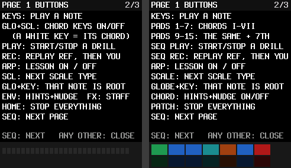
- **The help is genuinely usable**: three screens per page, purpose first, then buttons, then knobs; it fits.
- **The welcome screen** says exactly the three things a beginner needs.
- **Prompts on bars** (amber for a lesson waiting on you, green for your turn) are impossible to miss, and the result
  card stays until you play. 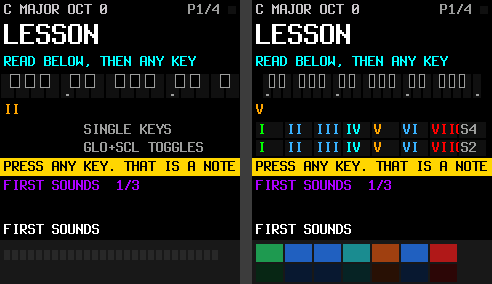
- **Page 2's grid** reads well: lane colours, the play head, chord cells, bass and melody rows.
- **Page 4's slot strip and song bar** show the song's shape at a glance. 

## Recommended order

1. **C1, C2, C3, H1, H2, H4, H5, H6** — small, contained code changes; one release.
2. **H8, H9, M1, M3, M4, M5** — the "everything from the screen" set for pages 2–4 and the pads.
3. **H3** — progress through SLOOP's settings store (needs care: it is the first time the layer would persist
   anything; keep it inside SLOOP's existing, tested settings write).
4. **C4, H7** — lesson content for pages 2–4 and per-board prompts.

## Gallery

All 47 states are in `docs/ui-review/` (`p<page>-<nn>-<state>.png`), FM-1 left, SMK-37 right.
